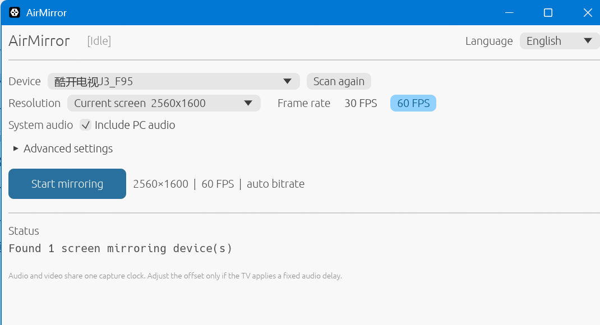

# AirMirror

[English](README.md) | [简体中文](README.zh-CN.md)


**Mirror a Windows desktop and system audio to an AirPlay-compatible TV.**

AirMirror is a Windows AirPlay sender written in Rust. It discovers receivers on
the local network, pairs automatically, captures the desktop with DXGI, encodes
H.264, and streams video and system audio over AirPlay.

> AirMirror is under active development. It has been tested on a small number of
> real receivers and is not yet a universal compatibility layer.



## Why AirMirror

Windows does not provide a native AirPlay screen-mirroring sender. AirMirror fills
that gap with a small desktop app and a scriptable CLI:

- No Apple device is required on the sending side.
- No PIN entry is needed for the tested transient pairing flow.
- Video and system audio use a shared media clock.
- Sessions reconnect automatically after network or capture failures.
- High-resolution NVENC capture is available through FFmpeg when supported.

## Features

- mDNS receiver discovery and direct IP or hostname connections
- Transient pair-setup, pair-verify, and persistent credentials
- DXGI Desktop Duplication capture
- OpenH264 software encoding and optional FFmpeg NVENC capture
- WASAPI loopback audio with ALAC encoding
- Live FPS, dropped frames, audio queue, CPU, memory, and A/V sync metrics
- Chinese and English desktop UI
- Quality presets from 720p10 to 2K/4K and ultrawide modes
- Synthetic test pattern and timed soak-test summaries

## Requirements

| Component | Requirement |
|---|---|
| OS | Windows 10/11 x64 |
| Rust | Stable toolchain, Rust 1.99+ |
| C++ toolchain | Visual Studio Build Tools with MSVC |
| Go | 1.21+ for the FairPlay helper |
| Receiver | A TV or AirPlay receiver that supports screen mirroring |
| Network | PC and receiver on the same reachable LAN |
| FFmpeg | Optional, required for the `ddagrab + h264_nvenc` path |

## Build

There are no release binaries yet. Build from the repository root:

```powershell
cargo build --release `
  --bin airmirror `
  --bin airmirror-gui `
  --bin airmirror-receiver-info
```

Build the required FairPlay helper separately:

```powershell
Push-Location tools\fpsap-helper
go build -trimpath -o ..\..\target\release\fpsap-helper.exe .
Pop-Location
```

The release directory should contain:

```text
target\release\
  airmirror.exe
  airmirror-gui.exe
  airmirror-receiver-info.exe
  fpsap-helper.exe
```

Keep `fpsap-helper.exe` next to the AirMirror executables, or make it available
on `PATH`.

## Quick Start

Check the local setup and, optionally, a receiver:

```powershell
.\target\release\airmirror.exe doctor `
  --target 192.168.1.50 `
  --port 7000
```

Launch the desktop app:

```powershell
.\target\release\airmirror-gui.exe
```

Or mirror directly from the CLI:

```powershell
.\target\release\airmirror.exe mirror `
  --target 192.168.1.50 `
  --port 7000 `
  --preset balanced `
  --hwaccel auto
```

Use a synthetic test pattern when checking protocol compatibility:

```powershell
.\target\release\airmirror.exe mirror `
  --target 192.168.1.50 `
  --test `
  --hwaccel none
```

## Commands

| Command | Description |
|---|---|
| `airmirror discover` | Scan the LAN for AirPlay receivers |
| `airmirror doctor` | Check helper, FFmpeg, credentials, and receiver status |
| `airmirror pair --target HOST` | Pair and save receiver credentials |
| `airmirror mirror --target HOST` | Start a mirroring session |
| `airmirror gui` | Open the GUI from the CLI binary |
| `airmirror-receiver-info info --target IP` | Query receiver capabilities |

Run any command with `--help` for the full option list.

## Quality Presets

| Preset | Resolution | FPS | Bitrate |
|---|---:|---:|---:|
| `compatibility` | 1280x720 | 10 | 2000 kbps |
| `balanced` | 1920x1080 | 15 | 4000 kbps |
| `quality` | 1920x1080 | 30 | Auto |
| `2k30` | 2560x1440 | 30 | 10000 kbps |
| `2k60` | 2560x1440 | 60 | 18000 kbps |
| `ultrawide30` | 3440x1440 | 30 | 12000 kbps |
| `ultrawide60` | 3440x1440 | 60 | 22000 kbps |
| `4k30` | 3840x2160 | 30 | 20000 kbps |
| `4k60` | 3840x2160 | 60 | 32000 kbps |

`--width`, `--height`, `--fps`, and `--bitrate` override individual preset
values. Start with `balanced` or `compatibility` when testing a new receiver.

## Configuration

Pairing credentials:

```text
%APPDATA%\airmirror\credentials.json
```

GUI settings:

```text
%APPDATA%\airmirror\gui-settings.json
```

The credentials file contains private key material. It is ignored by Git and
must not be shared.

System audio is enabled by default. If the receiver applies a fixed audio delay,
adjust it with `--audio-offset-ms`:

```powershell
--audio-offset-ms 10
```

Positive values delay audio; negative values advance it.

## Compatibility

Verified so far:

- Windows 10/11 desktop capture
- 1080p software encoding with OpenH264
- 2K60 direct GPU capture with FFmpeg NVENC
- System audio through WASAPI loopback
- Automatic reconnect after a dropped session
- 4K30 test-pattern decoding and display

Known limitations:

- New AirPlay implementations may require protocol or media-field adaptation.
- OpenH264 is best suited to 1080p and lower frame rates.
- 2K/4K high-refresh streaming depends on FFmpeg, NVENC, and NVIDIA hardware.
- AAC-ELD negotiation, long-duration audio validation, and VAAPI are incomplete.
- No installer, tray application, or auto-update flow is provided yet.

## Troubleshooting

| Problem | What to check |
|---|---|
| No receiver found | Firewall, mDNS, network isolation, or use `--target IP` |
| `fpsap-helper` missing | Build it and place it next to the executables |
| Pairing or FairPlay fails | Run `doctor` and inspect the receiver `/info` output |
| High-resolution stream stutters | Use a lower preset or enable the FFmpeg NVENC path |
| No system audio | Check Windows default output and receiver screen-audio support |
| Audio is out of sync | Adjust `--audio-offset-ms` and compare GUI metrics |

Enable extra protocol tracing when reporting a compatibility issue:

```powershell
$env:ROTTINGAPPLE_DEBUG_LOG = "1"
.\target\release\airmirror.exe mirror --target 192.168.1.50 --debug
```

Remove credentials, local paths, and device identifiers before posting logs.

## How It Works

AirMirror implements the AirPlay sender flow from discovery through media
playback: `/info`, transient pairing, pair-verify, FairPlay setup, RTSP
`SETUP`/`RECORD`, AES-128-CTR video packets, and an ALAC audio RTP timeline.

See [docs/implementation.md](docs/implementation.md) for protocol details and
[docs/roadmap-v0.4.md](docs/roadmap-v0.4.md) for current work.

## Development

```powershell
cargo test --workspace
cargo check --workspace --all-targets
```

Formatting intentionally excludes the vendored FairPlay implementation and
generated tables:

```powershell
cargo fmt `
  --package rotten-app `
  --package rotten-core `
  --package rotten-pairing `
  --package rotten-crypto `
  --package rotten-video `
  --package airmirror `
  -- --check
```

## Contributing

Issues and pull requests are welcome. Compatibility reports are most useful when
they include the receiver model, Windows version, selected preset, reproduction
steps, and sanitized logs.

## License

AirMirror is licensed under
[GPL-3.0-or-later](LICENSE). The project includes or links GPL-licensed FairPlay
components, so it cannot be relicensed as MIT or Apache-2.0 without replacing
those components.

Third-party notices are listed in
[THIRD_PARTY_NOTICES.md](THIRD_PARTY_NOTICES.md).
