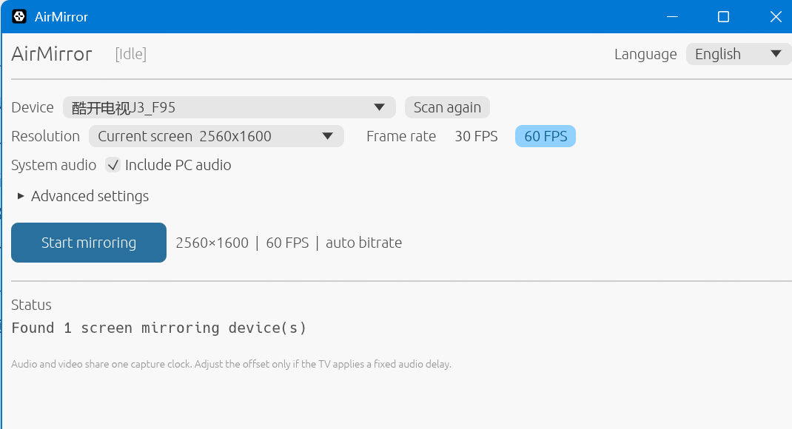

# AirMirror

[English](README.md) | 简体中文


**把 Windows 桌面和系统声音无线投屏到支持 AirPlay 的电视。**

AirMirror 是一个用 Rust 编写的 Windows AirPlay 发送端。它可以自动发现接收器、
完成无 PIN 配对、抓取桌面、编码 H.264，并把画面和系统声音发送到电视。

> 项目仍在持续开发，目前只验证了少量真实设备，尚不能保证兼容所有电视。



## 主要特性

- 局域网 mDNS 自动发现，也可以直接填写 IP 或主机名
- 无 PIN 的 transient 配对和凭据持久化
- DXGI 桌面抓屏和 OpenH264 软件编码
- 可选 FFmpeg `ddagrab + h264_nvenc` 高分辨率 GPU 路径
- WASAPI 系统声音回环和 ALAC 音频
- 自动重连、测试画面和定时长运行统计
- 中英文 GUI，实时显示帧率、丢帧、音画偏差和资源占用

## 环境要求

| 组件 | 要求 |
|---|---|
| 操作系统 | Windows 10/11 x64 |
| Rust | Stable，1.99+ |
| C++ 工具链 | Visual Studio Build Tools 和 MSVC |
| Go | 1.21+，用于构建 helper |
| 接收端 | 支持 AirPlay 屏幕镜像的电视或接收器 |
| 网络 | 电脑和接收端位于同一可互通的局域网 |
| FFmpeg | 可选，使用 NVENC 高分辨率路径时需要 |

## 构建

目前还没有提供预编译版本，请从源码构建：

```powershell
cargo build --release `
  --bin airmirror `
  --bin airmirror-gui `
  --bin airmirror-receiver-info
```

FairPlay helper 需要单独用 Go 构建：

```powershell
Push-Location tools\fpsap-helper
go build -trimpath -o ..\..\target\release\fpsap-helper.exe .
Pop-Location
```

`fpsap-helper.exe` 必须和 AirMirror 程序放在同一目录，或者加入 `PATH`。

## 快速开始

先检查环境和接收端：

```powershell
.\target\release\airmirror.exe doctor `
  --target 192.168.1.50 `
  --port 7000
```

启动图形界面：

```powershell
.\target\release\airmirror-gui.exe
```

或者直接使用命令行投屏：

```powershell
.\target\release\airmirror.exe mirror `
  --target 192.168.1.50 `
  --port 7000 `
  --preset balanced `
  --hwaccel auto
```

测试新设备时，建议先使用合成画面：

```powershell
.\target\release\airmirror.exe mirror `
  --target 192.168.1.50 `
  --test `
  --hwaccel none
```

## 常用命令

| 命令 | 作用 |
|---|---|
| `airmirror discover` | 扫描局域网中的 AirPlay 接收器 |
| `airmirror doctor` | 检查 helper、FFmpeg、凭据和接收端 |
| `airmirror pair --target HOST` | 配对并保存凭据 |
| `airmirror mirror --target HOST` | 开始投屏 |
| `airmirror gui` | 从主程序启动 GUI |
| `airmirror-receiver-info info --target IP` | 查询接收端能力 |

所有命令都可以使用 `--help` 查看完整参数。

## 画质预设

| 预设 | 分辨率 | 帧率 | 码率 |
|---|---:|---:|---:|
| `compatibility` | 1280x720 | 10 | 2000 kbps |
| `balanced` | 1920x1080 | 15 | 4000 kbps |
| `quality` | 1920x1080 | 30 | 自动 |
| `2k30` | 2560x1440 | 30 | 10000 kbps |
| `2k60` | 2560x1440 | 60 | 18000 kbps |
| `ultrawide30` | 3440x1440 | 30 | 12000 kbps |
| `ultrawide60` | 3440x1440 | 60 | 22000 kbps |
| `4k30` | 3840x2160 | 30 | 20000 kbps |
| `4k60` | 3840x2160 | 60 | 32000 kbps |

新设备建议从 `balanced` 或 `compatibility` 开始测试。`--width`、`--height`、
`--fps` 和 `--bitrate` 可以覆盖预设中的单项参数。

## 配置和凭据

配对凭据：

```text
%APPDATA%\airmirror\credentials.json
```

GUI 设置：

```text
%APPDATA%\airmirror\gui-settings.json
```

凭据文件包含私钥材料，已被 Git 忽略，请勿分享。系统音频默认开启；如果电视
存在固定音频延迟，可以使用 `--audio-offset-ms` 校准。

## 兼容性和限制

目前验证过 Windows 桌面抓屏、1080p OpenH264、2K60 FFmpeg NVENC、系统音频、
自动重连和 4K30 测试画面。

已知限制：

- 不同 AirPlay 实现可能需要协议和媒体字段适配
- OpenH264 更适合 1080p 和较低帧率
- 2K/4K 高刷依赖 FFmpeg、NVENC 和 NVIDIA 显卡
- AAC-ELD、VAAPI、长时间音频稳定性和安装包尚未完成

## 故障排查

| 现象 | 检查项 |
|---|---|
| 找不到设备 | 防火墙、mDNS、网络隔离，或改用 `--target IP` |
| 提示 helper 缺失 | 构建 `fpsap-helper.exe` 并放到主程序同目录 |
| 配对或 FairPlay 失败 | 运行 `doctor`，检查接收端 `/info` 输出 |
| 高分辨率卡顿 | 降低预设，或启用 FFmpeg NVENC 路径 |
| 没有系统声音 | 检查 Windows 默认输出和接收端音频能力 |
| 音画不同步 | 调整 `--audio-offset-ms`，观察 GUI 指标 |

提交兼容性问题前可以启用协议调试日志：

```powershell
$env:ROTTINGAPPLE_DEBUG_LOG = "1"
.\target\release\airmirror.exe mirror --target 192.168.1.50 --debug
```

分享日志前请删除凭据、本机路径和设备标识。

## 实现文档

协议握手、密钥派生和媒体时间线见
[docs/implementation.md](docs/implementation.md)，当前开发进度见
[docs/roadmap-v0.4.md](docs/roadmap-v0.4.md)。

## 开发

```powershell
cargo test --workspace
cargo check --workspace --all-targets
```

格式化检查不处理 vendored FairPlay 源码和生成表：

```powershell
cargo fmt `
  --package rotten-app `
  --package rotten-core `
  --package rotten-pairing `
  --package rotten-crypto `
  --package rotten-video `
  --package airmirror `
  -- --check
```

## 贡献

欢迎提交 issue 和 pull request。兼容性报告请包含电视型号、Windows 版本、
画质预设、复现步骤和脱敏后的日志。

## 许可证

项目采用 [GPL-3.0-or-later](LICENSE)。项目包含或链接 GPL 的 FairPlay 组件，
因此不能在未替换相关组件的情况下改为 MIT 或 Apache-2.0。

第三方组件见 [THIRD_PARTY_NOTICES.md](THIRD_PARTY_NOTICES.md)。
